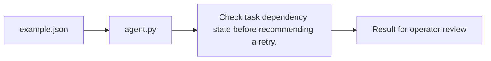

# Adb Pipeline Agent architecture

Identify failed dependencies before retrying an Azure Databricks-style pipeline.

## Operational boundaries

The documented run evaluates the bundled sample locally. Results depend on the quality and scope of the input. The demo makes no live infrastructure changes.
